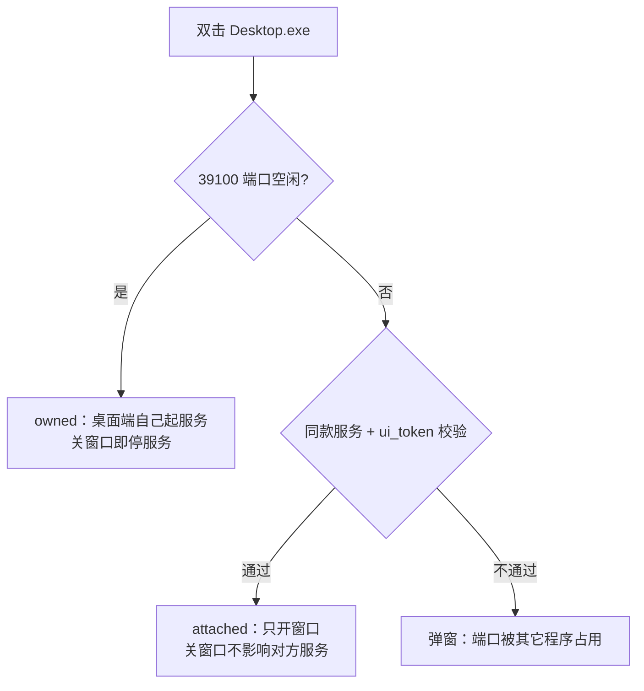
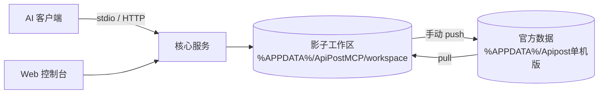

# API MCP

Windows 版 API版 MCP 服务。对外提供与官方完全一致的 **30 个 `apipost_*` 工具**，采用**影子工作区**安全模型：官方数据目录只读，AI 的所有写入先落影子，你确认后再手动推送到 Apipost。

## 特性

- **30 个工具，与官方一一对应** — `apipost_list_projects` … `apipost_get_execution_result`
- **可视化接口编辑器** — 控制台内直接新建/编辑/删除接口、目录、文档，含参数表、Body、鉴权、前后置脚本、响应示例
- **影子副本策略** — `%APPDATA%\Apipost单机版\` 全程只读，写入只落 `%APPDATA%\ApiPostMCP\workspace\`
- **三方比对同步** — `sha256` 基线比对，逐文件识别 `ahead / behind / conflict`，冲突可逐文件选边
- **完整 apt 脚本沙箱** — `apt.environment/globals/variables`、`setRequestHeader/Query/Body`、`response.json/text`、`cookies`、`apt.test/apt.expect`
- **官方同款主题** — 暖纸金（默认）/ 暗色 / 自定义底色，配色取自 Apipost 单机版主题 token
- **双模式** — 常驻 HTTP 服务（含 Web 控制台）+ `--stdio`（供 MCP 客户端直连）
- **单文件交付** — `dist/apipost-mcp.exe`，运行时零依赖
- **可选的桌面端** — Electron 独立窗口，双击即用，不需要浏览器标签页

## 快速开始

```powershell
# 1. 构建
npm install
npm run build

# 2. 启动（会自动打开控制台）
.\dist\apipost-mcp.exe
```

控制台地址会打印在终端，形如 `http://127.0.0.1:39100/?ui=<token>`。

### 想要独立窗口（桌面端）

`apipost-mcp.exe` 默认在浏览器里打开控制台。如果希望像普通桌面软件那样以独立窗口运行：

```powershell
npm run build:desktop
.\dist\desktop\ApiPostMCP-Desktop-win32-x64\ApiPostMCP-Desktop.exe
```

窗口无地址栏、无标签页，顶栏即标题栏，右上角是原生窗口按钮。详见下方「桌面端」。

### 配置到 Cursor

打开控制台 → **客户端配置** → 选 **Cursor** → 复制，粘到 `%USERPROFILE%\.cursor\mcp.json`：

```json
{
  "mcpServers": {
    "apipost-offline": {
      "command": "D:\\work\\ApiPost\\dist\\apipost-mcp.exe",
      "args": ["--stdio"]
    }
  }
}
```

## 命令行

| 参数 | 说明 |
|---|---|
| （无参数） | 启动常驻服务 + 自动打开控制台 |
| `--stdio` | 作为 stdio MCP 服务运行（客户端拉起） |
| `--serve` | 只启动 HTTP 服务，不开浏览器 |
| `--data-root <dir>` | 指定 Apipost 单机版数据目录 |
| `--shadow-root <dir>` | 指定影子工作区目录 |
| `--port <n>` | 监听端口（默认 39100） |
| `--version` / `--help` | 版本 / 帮助 |

环境变量：`APIPOST_DATA_ROOT`、`APIPOST_MCP_HOME`、`APIPOST_MCP_CONFIG`

## 桌面端（Electron 独立窗口）

`apipost-mcp.exe` 走系统浏览器；如果不想在浏览器标签页里操作控制台，可以构建桌面端：

```powershell
npm run build:desktop
# 产物：dist/desktop/ApiPostMCP-Desktop-win32-x64/
```

分发时**整个目录一起拷贝**（Electron 运行时依赖同目录下的 dll、locales 等）。

| 特性 | 说明 |
|---|---|
| 外观 | 无地址栏/标签页，顶栏即标题栏，右上角为原生窗口按钮 |
| 主题 | 标题栏配色跟随控制台的暖纸金/暗色/自定义主题 |
| 服务 | 服务跑在桌面端进程内；也可附着到已运行的 `apipost-mcp.exe` |
| 单实例 | 重复双击只聚焦已有窗口 |
| 记忆 | 窗口尺寸/位置/最大化状态存在 `%APPDATA%\ApiPostMCP\desktop-window.json` |
| 外链 | 站外链接交给系统浏览器，页面内不允许任意导航 |

桌面端与 SEA 单文件版的启动关系：



桌面端支持与 SEA 版相同的 `--port` / `--data-root` / `--shadow-root`。
开发调试：`set APIPOST_MCP_DEV=1` 后可开 F12 / Ctrl+Shift+I 开发者工具；`npm run dev:desktop` 免打包直接跑。

## 同步模型



- **pull**：把 Apipost 最新数据同步到影子（有未推送改动时默认拒绝，`force` 可强制）
- **push**：把影子改动写回 Apipost（**唯一**写官方目录的路径，只能手动点击）
- **冲突**：两侧都改同一文件时标为 `diverged`，需逐文件选择保留侧
- **例外**：`apipost_create_project` 直接写官方（目标目录不存在，无覆盖风险），随后自动拉影子

## 目录结构

```
src/
  main.js              CLI 入口（SEA 单文件版）
  desktop/             桌面端（Electron 主进程 / preload / 服务附着 / 窗口状态）
  store/               影子数据读写（paths/projects/apis/envs/flows/runs/shadow）
  sync/                三方比对与 pull/push
  exec/                执行引擎（http/auth/template/assert/script/runner）
  mcp/                 工具定义（schemas/tools）、协议（protocol）、stdio
  openapi/convert.js   OpenAPI 3.0/3.1 转换
  server/              HTTP 服务、配置、客户端配置生成
web/                   控制台（index.html / app.js / design.js / theme.css / style.css）
build/                 gen-icon.mjs 生成的 icon.ico / icon.png
test/                  node:test 测试
scripts/               gen-assets.mjs / gen-icon.mjs / build.mjs / build-desktop.mjs
```

## 测试

```powershell
npm test
```

覆盖：模板变量优先级、鉴权构造、schema 校验、OpenAPI 转换、同步四方场景（synced/ahead/behind/diverged）、存储 CRUD、执行引擎（含脚本沙箱、跨步骤传值、步骤快照固化）、MCP 协议、HTTP 服务鉴权、接口编辑器 CRUD（含级联删除与 push 验证）、桌面端服务附着与窗口状态。

## 控制台

| 菜单 | 功能 |
|---|---|
| 总览 | 服务状态、Token、数据目录、快速开始 |
| 项目与同步 | 项目授权、拉取/推送、文件级差异与冲突处理 |
| 接口设计 | 接口树 + 六页签编辑器（基础 / 参数 / Body / 鉴权 / 脚本 / 响应） |
| 客户端配置 | Cursor / Claude Code / VS Code / Trae / Codex 配置一键复制 |
| 工具清单 | 30 个 MCP 工具说明 |
| 外观设置 | 暖纸金 / 暗色 / 自定义底色 + 字号缩放 |
| 关于 | 版本与路径信息 |

「接口设计」的编辑全部落在影子工作区，保存后需到「项目与同步」点推送才会写入 Apipost 单机版。

## 工具清单

| 分类 | 工具 |
|---|---|
| 项目与 API | `list_projects` `create_project` `list_apis` `get_api_detail` `sync_openapi` `delete_apis` |
| 接口执行 | `execute_api` |
| 环境与变量 | `list_environments` `switch_environment` `create_environment` `update_environment` `delete_environment` `list_environment_servers` `create_environment_server` `update_environment_server` `delete_environment_server` `get_environment_variables` `upsert_environment_variable` `delete_environment_variable` `get_global_variables` `upsert_global_variable` `delete_global_variable` |
| 执行计划 | `create_execution_flow` `update_execution_flow` `list_execution_flows` `get_execution_flow` `delete_execution_flow` `execute_flow` |
| 执行历史 | `list_execution_runs` `get_execution_result` |

## 限制

- 仅支持 HTTP 接口执行（`target_type === 'api'`）；SSE / WebSocket / gRPC / Mock / 数据库请求不在工具范围内
- 鉴权支持 `noauth / basic / bearer / kv(apikey) / oauth2(静态 token) / inherit`；`awsv4 / digest / hawk / ntlm / oauth1 / edgegrid / asap / jwt` 会明确报错
- 一个项目同一时刻只建议一个写入方；Apipost 打开并正在编辑时，请保存后再 pull

## 免责

本软件与 Apipost 官方无隶属关系，仅按官方 MCP 工具语义读写你本机 Apipost 单机版的项目数据。默认影子副本策略下官方数据零风险。
