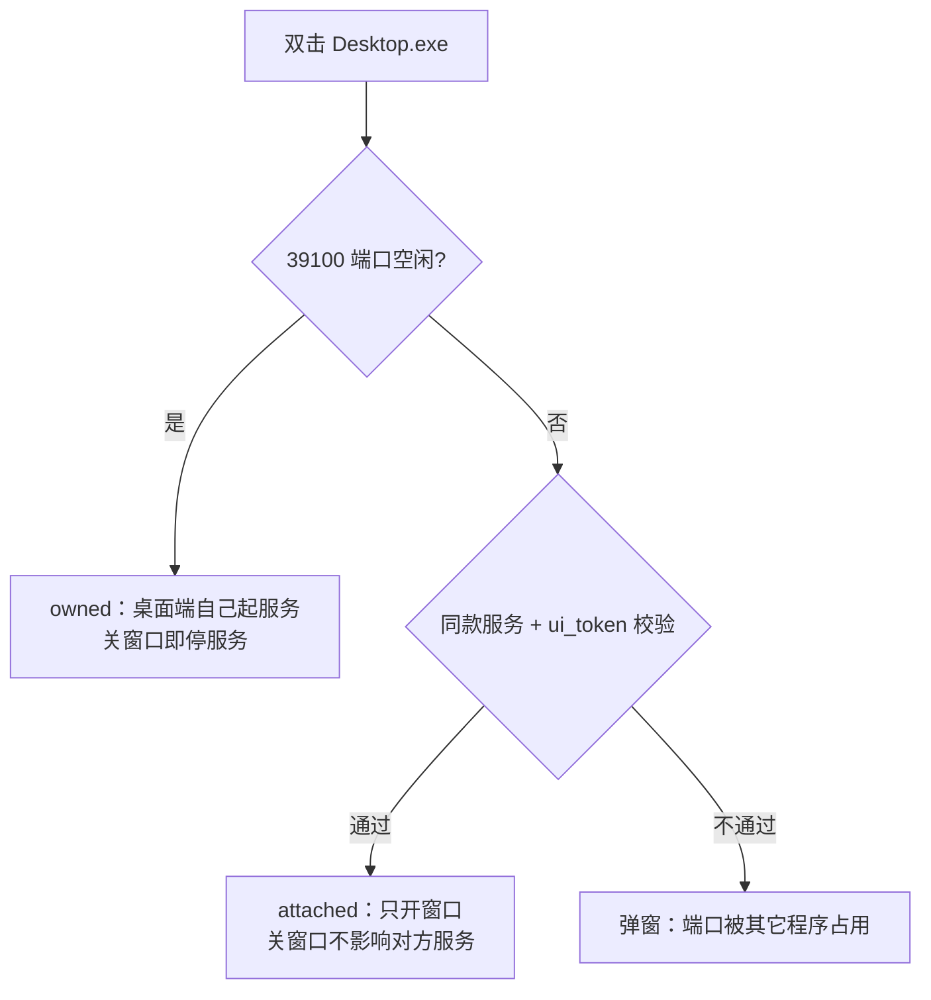
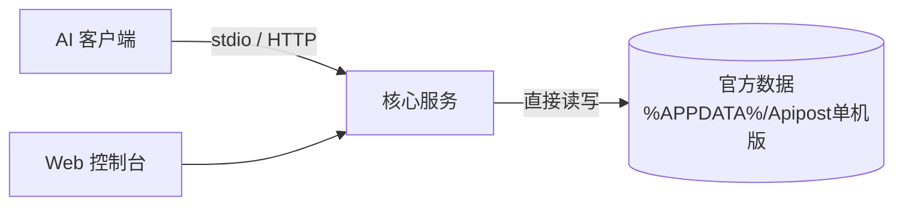

# API MCP

Windows 版 API版 MCP 服务。

## 特性

- **32 个工具**（官方 30 个 + 全局参数 2 个）— `apipost_list_projects` … `apipost_update_global_params`
- **可视化接口编辑器** — 控制台内直接新建/编辑/删除接口、目录、文档，含参数表、Body、鉴权、前后置脚本、响应示例
- **环境管理** — 多环境切换、环境变量、多 host 服务（前置 URL）；目录可指定服务，其下接口优先使用
- **全局参数与全局变量** — 全局 / 目录 / 接口三层继承（Header、Query、Cookie、Body、鉴权、前后置脚本），环境变量优先于全局变量
- **完整 apt 脚本沙箱** — `apt.environment/globals/variables`、`setRequestHeader/Query/Body`、`response.json/text`、`cookies`、`apt.test/apt.expect`
- **官方同款主题** — 暖纸金（默认）/ 暗色 / 自定义底色，配色取自 Apipost 单机版主题 token
- **双模式** — 常驻 HTTP 服务（含 Web 控制台）+ `--stdio`（供 MCP 客户端直连）
- **单文件交付** — `dist/apimcp.exe`，运行时零依赖
- **可选的桌面端** — Electron 独立窗口，双击即用，不需要浏览器标签页

## 快速开始（用打包好的 exe）

不需要装 Node，也不需要 `npm install`，直接拿两个产物之一即可：

| 产物 | 位置 | 适合谁 |
|---|---|---|
| **命令行 / 浏览器版** | `dist/apimcp.exe` | 给 AI 客户端当 MCP 服务用，或习惯在浏览器里操作 |
| **桌面端（独立窗口）** | `dist/desktop/ApiMCP-Desktop-win32-x64/ApiMCP-Desktop.exe` | 想要一个像普通软件那样的窗口 |

两者数据完全共享，用哪个都行，也可以同时用。

### 前置条件

1. 已安装并至少打开过一次 **API 单机版**（Apipost 离线版），让数据落在 `%APPDATA%\Apipost单机版\`
2. 如果数据不在默认位置，用 `--data-root` 指定，或在控制台「外观设置 → 数据目录」里改

### 方式一：`apimcp.exe`（浏览器控制台）

**双击运行**即可，它会：

1. 起一个本地服务（默认 `127.0.0.1:39100`）
2. 自动用系统默认浏览器打开控制台，地址形如 `http://127.0.0.1:39100/?ui=<token>`

终端里会打印这些信息，其中 `?ui=<token>` 就是控制台入口，**不要漏掉**（没有 token 打不开控制台）：

```
  API MCP 服务已启动
  数据目录: C:\Users\<你>\AppData\Roaming\Apipost单机版
  控制台  : http://127.0.0.1:39100/?ui=xxxxxxxx
  MCP 端点: http://127.0.0.1:39100/mcp
  Token   : xxxxxxxx
  配置    : C:\Users\<你>\AppData\Roaming\ApiMCP\config.json
```

> 双击后如果只弹出一个黑框，说明服务已在运行，**别关这个窗口**——关了服务就停了。

```powershell
# 常用启动方式
.\apimcp.exe                         # 起服务 + 打开浏览器
.\apimcp.exe --serve                 # 只起服务，不打开浏览器
.\apimcp.exe --serve --port 39101    # 换端口
.\apimcp.exe --data-root "D:\data"   # 指定 API 单机版数据目录
.\apimcp.exe --help                  # 查看全部参数
```

**首次使用建议顺序**：双击 exe → 浏览器打开控制台 → 「总览」打开 **MCP 服务开关**（默认关闭）、确认数据目录探测成功、勾选要开放的项目 → 开始用。

> 服务默认处于**停用**状态，首次使用需要手动打开「总览」里的运行开关；开启后 HTTP 与 stdio 两种接入方式才可用。
### 方式二：`ApiMCP-Desktop.exe`（独立窗口）

双击 `ApiMCP-Desktop.exe` 即可，无地址栏、无标签页，关窗口等于关这个软件。

> 分发时**整个 `ApiMCP-Desktop-win32-x64` 目录一起拷贝**（约 350 MB，含 Electron 运行时）。只拿一个 exe 会打不开。

它和你已有的 `apimcp.exe` 的关系：

| 情况 | 行为 |
|---|---|
| 39100 端口空闲 | 桌面端自己起服务，**关窗口即停服务** |
| `apimcp.exe` 已在跑 | 自动「附着」，只开窗口，**关窗口不影响那边** |
| 端口被别的程序占了 | 弹窗提示，用 `--port` 换端口 |

桌面端支持同样的 `--port` / `--data-root`。

```powershell
# 用快捷方式或命令行带参数启动
ApiMCP-Desktop.exe --port 39101
```

### 配到 AI 客户端（Cursor / Claude Code / VS Code / Trae / Codex）

不用手写配置：打开控制台 → 左侧「**客户端配置**」→ 选你的客户端 → 点复制 → 粘到对应文件里。

以 Cursor 为例，粘到 `%USERPROFILE%\.cursor\mcp.json`：

```json
{
  "mcpServers": {
    "apimcp": {
      "command": "D:\\path\\to\\dist\\apimcp.exe",
      "args": ["--stdio"]
    }
  }
}
```

> `--stdio` 由客户端自己拉起进程，**不需要**先双击 exe。`command` 要写**绝对路径**。

### 数据在哪

| 内容 | 路径 |
|---|---|
| API 单机版数据（读写） | `%APPDATA%\Apipost单机版\` |
| 本软件配置 | `%APPDATA%\\ApiMCP\config.json` |
| 桌面端窗口位置记忆 | `%APPDATA%\\ApiMCP\desktop-window.json` |

改动直接写入 API 单机版目录，重新进入项目即可看到。

### 从源码构建

```powershell
npm install
npm run build          # → dist/apimcp.exe
npm run build:desktop  # → dist/desktop/ApiMCP-Desktop-win32-x64/（约 6 分钟）
```

## 命令行

| 参数 | 说明 |
|---|---|
| （无参数） | 启动常驻服务 + 自动打开控制台 |
| `--stdio` | 作为 stdio MCP 服务运行（客户端拉起） |
| `--serve` | 只启动 HTTP 服务，不开浏览器 |
| `--no-open` | 不自动开浏览器（其余行为同无参数） |
| `--open` | 强制打开浏览器 |
| `--data-root <dir>` | 指定 Apipost 单机版数据目录 |
| `--port <n>` | 监听端口（默认 39100） |
| `--version` / `--help` | 版本 / 帮助 |

环境变量：`APIPOST_DATA_ROOT`、`APIMCP_HOME`、`APIMCP_CONFIG`

## 常见问题

**双击后没反应 / 一闪而过**
检查 39100 端口是否已被占用：`netstat -ano | findstr :39100`。被同款服务占着属正常（可继续用那个），被别的程序占了就换端口启动。

**浏览器打开后提示没有 token / 打不开控制台**
控制台地址必须带着 `?ui=<token>`。地址在 exe 启动时的终端输出里，也能在 `%APPDATA%\\ApiMCP\config.json` 的 `ui_token` 字段找到。

**控制台显示「未找到 API 单机版数据目录」**
先安装并打开一次 API 单机版；数据不在默认位置时，用 `--data-root "D:\..."` 指定，或在控制台「外观设置 → 数据目录」里填。

**改了接口但 API 单机版里没变**
改动会直接写入官方目录。如果界面没刷新，在 API 单机版里关掉项目重新进入即可。

**关了 exe 黑框，服务就没了**
`apimcp.exe` 是前台进程，关掉即停服务。想常驻，把快捷方式丢进 `shell:startup`（Win+R 输入）并把「运行方式」设为最小化。

**桌面端只拷了 exe，打不开**
必须整个 `ApiMCP-Desktop-win32-x64` 目录一起拷，Electron 运行时在同目录的 dll 和 `locales/` 里。

**配到 Cursor 后工具调不通**
`mcp.json` 里的 `command` 必须是 exe 的**绝对路径**；改完要重启 Cursor。可先用控制台「客户端配置」页面复制，避免手写出错。

## 桌面端（Electron 独立窗口）

`apimcp.exe` 走系统浏览器；如果不想在浏览器标签页里操作控制台，用桌面端：

```powershell
npm run build:desktop
# 产物：dist/desktop/ApiMCP-Desktop-win32-x64/
```

分发时**整个目录一起拷贝**（Electron 运行时依赖同目录下的 dll、locales 等）。

| 特性 | 说明 |
|---|---|
| 外观 | 无地址栏/标签页，顶栏即标题栏，右上角为原生窗口按钮 |
| 主题 | 标题栏配色跟随控制台的暖纸金/暗色/自定义主题 |
| 服务 | 服务跑在桌面端进程内；也可附着到已运行的 `apimcp.exe` |
| 单实例 | 重复双击只聚焦已有窗口 |
| 记忆 | 窗口尺寸/位置/最大化状态存在 `%APPDATA%\\ApiMCP\desktop-window.json` |
| 外链 | 站外链接交给系统浏览器，页面内不允许任意导航 |
| 选文件 | Body 的 `binary` 模式可直接弹原生文件选择框 |

桌面端与 SEA 单文件版的启动关系：



开发调试：`set APIPOST_MCP_DEV=1` 后可开 F12 / Ctrl+Shift+I 开发者工具；`npm run dev:desktop` 免打包直接跑。

## 数据流



控制台与 MCP 工具读写同一份 Apipost 官方数据，没有中间工作区，也没有拉取 / 推送步骤。

## 目录结构

```
src/
  main.js              CLI 入口（SEA 单文件版）
  desktop/             桌面端（Electron 主进程 / preload / 服务附着 / 窗口状态）
  store/               数据读写（paths/projects/apis/envs/flows/runs/recent/target）
  exec/                执行引擎（http/auth/template/assert/script/runner）
  mcp/                 工具定义（schemas/tools）、协议（protocol）、stdio
  openapi/convert.js   OpenAPI 3.0/3.1 转换
  server/              HTTP 服务、配置、客户端配置生成
web/                   控制台（index.html / app.js / design.js / theme.css / style.css）
build/                 gen-icon.mjs 生成的 icon.ico（9 档多尺寸）/ icon.png
test/                  node:test 测试
scripts/               gen-assets.mjs / gen-icon.mjs / build.mjs / build-desktop.mjs
```

## 测试

```powershell
npm test
```

覆盖：模板变量优先级、鉴权构造、schema 校验、OpenAPI 转换、直连官方目录读写（含越界保护）、存储 CRUD、执行引擎（含脚本沙箱、跨步骤传值、步骤快照固化）、MCP 协议、HTTP 服务鉴权、接口编辑器 CRUD（含级联删除与官方目录落盘验证）、桌面端服务附着与窗口状态、五页签数据域隔离（`preserve_aux`）、调试详情（`live_detail`）、用例响应头 / Content-Type 校验、压测进度时间线、Mock 自定义响应头、图标 ICO 结构。

## 控制台

| 菜单 | 功能 |
|---|---|
| 总览 | 服务状态、Token、数据目录、项目授权、快速开始 |
| 环境与变量 | 三个页签：环境（多环境 + 环境变量 + 多 host 服务）、全局参数（含目录参数继承）、全局变量 |
| 接口设计 | 接口树 + 六页签编辑器（基础 / 参数 / Body / 鉴权 / 脚本 / 响应），右侧另有设计 / 调试 / 接口用例 / 一键压测 / Mock 五个独立数据域；目录也有「基础 / 参数 / Body / 鉴权 / 脚本」五个子页签 |
| 客户端配置 | Cursor / Claude Code / VS Code / Trae / Codex 配置一键复制 |
| 工具清单 | 32 个 MCP 工具说明 |
| 外观设置 | 暖纸金 / 暗色 / 自定义底色 + 字号缩放 |
| 关于 | 版本与路径信息 |

「接口设计」的编辑直接写入 API 单机版目录，保存后重新进入项目即可看到。

设计 / 调试 / 接口用例 / 一键压测 / Mock 五个页签各自独立：设计保存只提交设计字段（不会覆盖用例与 Mock），用例与 Mock 页签各有自己的「未保存」标记与 Ctrl+S，压测与 Mock 页签的请求栏只读。

「调试」页签展示实际发出的完整请求头、Query、请求体、状态行、响应头、逐条 `Set-Cookie` 与实际 URL，并支持「隐藏敏感值」开关与「复制为 cURL」。这些详情只在本机即时返回，落盘的执行历史仍按 `authorization / cookie / token` 等敏感键打码。

## 工具清单

| 分类 | 工具 |
|---|---|
| 项目与 API | `list_projects` `create_project` `list_apis` `get_api_detail` `sync_openapi` `delete_apis` |
| 接口执行 | `execute_api` |
| 环境与变量 | `list_environments` `switch_environment` `create_environment` `update_environment` `delete_environment` `list_environment_servers` `create_environment_server` `update_environment_server` `delete_environment_server` `get_environment_variables` `upsert_environment_variable` `delete_environment_variable` `get_global_variables` `upsert_global_variable` `delete_global_variable` `get_global_params` `update_global_params` |
| 执行计划 | `create_execution_flow` `update_execution_flow` `list_execution_flows` `get_execution_flow` `delete_execution_flow` `execute_flow` |
| 执行历史 | `list_execution_runs` `get_execution_result` |

## 限制

- 仅支持 HTTP 接口执行（`target_type === 'api'`）；SSE / WebSocket / gRPC / Mock / 数据库请求不在工具范围内
- 鉴权支持 `noauth / basic / bearer / kv(apikey) / oauth2(静态 token) / inherit`；`awsv4 / digest / hawk / ntlm / oauth1 / edgegrid / asap / jwt` 会明确报错
- 全局/目录参数的 Body 只支持 `form-data` 与 `urlencoded`（对齐官方限制）；Header / Query / Cookie / 鉴权 / 前后置脚本可继承
- 全局参数与目录参数的执行顺序：前置脚本 `全局 → 目录 → 接口`，后置脚本 `接口 → 目录 → 全局`；同名参数内层优先，内层 `is_checked = -1` 表示禁用外层同名项
